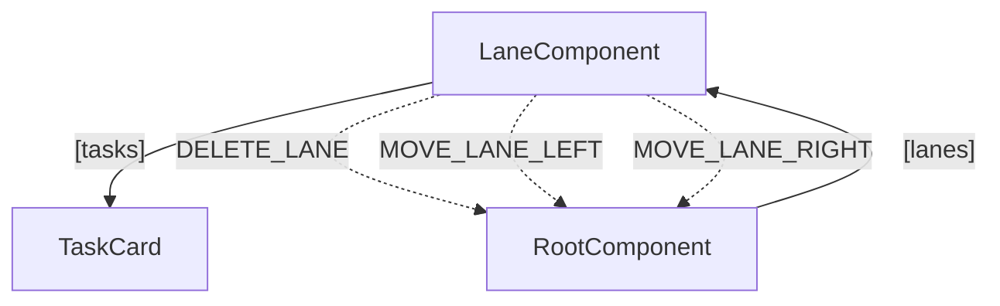

# Sygnal

**A reactive JSX framework where every change in your app has a name, a cause, and one place to read it.**

[](https://www.npmjs.com/package/sygnal)
[](https://www.npmjs.com/package/sygnal)
[](https://github.com/tpresley/sygnal/blob/main/LICENSE)

Sygnal components are plain functions. There are no hooks, no handlers in your markup and no store to wire up. What happens, and when, is declared right beside the view as data.

It's a small, slightly unusual way to write front-end code, with a payoff that keeps growing: your app stays readable, by you, by your tools and by your coding agents, however big it gets and whoever wrote it.

## A whole component

```jsx
function Counter({ state }) {
  return (
    <div>
      <h1>Count: {state.count}</h1>
      <button className="increment">+</button>
      <button className="reset">Reset</button>
    </div>
  )
}

Counter.initialState = { count: 0 }

Counter.intent = ({ DOM }) => ({
  INCREMENT: DOM.click('.increment'),
  RESET: DOM.click('.reset'),
})

Counter.model = {
  INCREMENT: (state) => ({ ...state, count: state.count + 1 }),
  RESET: (state) => ({ ...state, count: 0 }),
}
```

That's all of it. Call `run(Counter)` and it's live.

Look at what the view doesn't have: there isn't a single click handler in it. Each part of the component does one job.

- **The view** says what the screen looks like, as a function of state.
- **`intent`** says *when* things happen, turning raw events into named actions.
- **`model`** says *what changes* when they do, one plain function per action.

This is Model-View-Intent, the pattern Sygnal inherits from [Cycle.js](https://cycle.js.org/). It can feel odd for the first few minutes. Then you notice that you always know where to look.

Side effects follow the same idea. An action describes what should happen, and a driver does it:

```jsx
Quote.model = {
  LOAD:   { HTTP: (state, id) => ({ url: `/api/quotes/${id}`, ok: 'LOADED', error: 'FAILED', latest: true }) },
  LOADED: (state, quote) => ({ ...state, quote }),
  FAILED: (state, { status }) => ({ ...state, error: status }),
}
```

There's no `fetch` in the component, no flag to guard against stale responses, and no cleanup function. The reply simply arrives as another named action.

**Try it:**

```bash
npm create sygnal-app my-app
```

Or [play with it in your browser](https://sygnal.js.org/try-it/), no install needed.

## Why this matters now

More of the code in our apps is being written by agents, and that changes what we need from a framework. Producing code keeps getting easier. Knowing what it does is still the job, and if you love this craft, it's the part worth holding on to.

In most front-end code, the answers live inside closures: what this click does, who reads this state, when this effect runs. You find out by reading everything or by running it. In Sygnal, those answers are declarations, which means you can read them directly, and so can a machine.

## See your whole app at once

`sygnal-check` reads your source, without running it, and maps what every component does:

```text
$ npx sygnal-check --graph

LaneComponent  src/LaneComponent.jsx:4  collection-item
  actions   ADD_TASK (intent → STATE writes isAddingTask, tasks), DELETE_LANE (intent → EVENTS), …
  reads     id, isEditing, titleDraft, title, isFirst, isLast, isAddingTask, tasks
  events    emits DELETE_LANE, MOVE_LANE_LEFT, MOVE_LANE_RIGHT
  children  TaskCard (collection from 'tasks')
  parent    from TaskCard → DELETE_TASK
```

Every action, what triggers it and which state it writes, across the whole app. On a 63,000-line console, the graph covers 110 components and 619 actions in 1.3 seconds.

It's also an [interactive page](https://sygnal.js.org/guide/app-graph/) where you can click an event or a state key and light up everything involved, and it's JSON for your agent and Mermaid for your docs. This is the [kanban example](./examples/kanban):



**Then review what a change actually did.** `--base` compares the app's behavior with any git ref. Here, a change added an Archive button to that board:

```text
$ npx sygnal-check --graph --base main

~ LaneComponent: +action ARCHIVE, +emits ARCHIVE_LANE, +selector .archive-lane-btn,
  +diagnostic SYG105 EVENTS type 'ARCHIVE_LANE' is emitted but nothing in the scanned files selects it
EVENTS: +ARCHIVE_LANE
0 added, 0 removed, 1 changed
```

Three lines of diff, one sentence of meaning: the button renders, and clicking it does nothing. You can catch that in code review without opening the app.

## Test it, and see it, without a browser or a server

Reducers and views are plain functions. Everything else runs in Node, with real events and no DOM to set up:

```js
import { test, expect } from 'vitest'
import { renderComponent } from 'sygnal'
import Counter from './Counter.jsx'

test('reducers are plain functions', () => {
  expect(Counter.model.INCREMENT({ count: 1 })).toEqual({ count: 2 })
})

test('clicks work', async () => {
  const t = renderComponent(Counter)
  await t.ready()

  t.simulateEvent('.increment', 'click')
  await t.next((s) => s.count === 1)

  t.expectNoDiagnostics()
  t.dispose()
})
```

HTTP replies, model streams and timers are faked through the same harness. A real session can even be [recorded and replayed as a test](https://sygnal.js.org/guide/record-replay/) that names the first action whose result changed (experimental).

Because the outside world comes in through drivers, the same trick works for your eyes too. Swap the drivers for fixtures and you can sweep every screen and state of the real components on mock data, or hand someone a click-through of the actual app with no server behind it.

## A click and an LLM's tool call are the same thing

Every input to a Sygnal app is an action, so giving a model access to your app means naming which actions it may run:

```jsx
Counter.agent = {
  name: 'counter',
  description: 'A counter',
  read: (state) => ({ count: state.count }),
  actions: {
    INCREMENT: { description: 'Add one' },
    RESET: { description: 'Back to zero', consequential: true },   // the user confirms first
  },
}
```

Those tools run through the same reducers as your buttons, show up in the same log and graph, and are tested the same way. One declaration serves an in-app assistant, a command bar, an MCP host or a coding agent.

Sygnal has the rest of the AI toolkit built in, using the same drivers and actions as everything else: [streaming chat](https://sygnal.js.org/ai/chat/), [typed decisions](https://sygnal.js.org/ai/decisions/), [UI composed by a model](https://sygnal.js.org/ai/composed-ui/) from your own components, and [WebMCP and MCP Apps](https://sygnal.js.org/ai/agentic-web/) (WebMCP is experimental).

The model chooses. Your app does.

## Made to work with your coding agent

Sygnal gives agents one canonical way to write each pattern, so what they produce looks like what you'd expect to read.

- [`llms.txt`](https://sygnal.js.org/llms.txt) and a [Claude Code plugin](https://sygnal.js.org/integration/agents/#the-sygnal-dev-skill) teach the current API.
- `sygnal-check` turns silent wiring mistakes into coded findings with fixes, from the CLI, an [MCP server](https://sygnal.js.org/integration/agents/#mcp-server) or your editor.
- A [dev server MCP endpoint](https://sygnal.js.org/integration/agents/#dev-server-mcp-endpoint) shows an agent the running app's state, actions and diagnostics.

`npm create sygnal-app` sets all of this up for you.

## What else is in the box

Lists with filtering and sorting, in one line:

```jsx
<Collection of={TodoItem} from="items" filter={item => !item.done} sort="name" />
```

Derived state and data for the whole tree, declared rather than wired:

```jsx
Invoice.calculated = {
  subtotal: [['items'], (state) => sum(state.items.map(i => i.price))],
  total:    [['subtotal'], (state) => state.subtotal * 1.08],
}

App.context = {
  currentUser: (state) => state.auth.user,
}
```

Also included: [routing](https://sygnal.js.org/guide/router/), [forms](https://sygnal.js.org/guide/forms/), [data fetching with caching](https://sygnal.js.org/guide/resources/), sockets, [accessible UI parts](https://sygnal.js.org/ui/overview/), drag and drop, [undo](https://sygnal.js.org/advanced/undo/), transitions, SSR with Vike and Astro, HMR that keeps your state, DevTools with time travel, and full TypeScript types. The same components can also target the [terminal, React Native, three.js and canvas](https://sygnal.js.org/renderers/overview/).

In preview or experimental: WebMCP, generated UI, `sygnal/replay`, `sygnal/canvas`, `sygnal/worker`, `sygnal/yjs`, `sygnal/api`, `sygnal/sandbox`.

## Is Sygnal right for your project?

Sygnal is a new approach, and it pays off most when you need to understand, review and verify code you didn't write yourself. Here's what to weigh against that:

- **Your agent has to learn it.** Models already know React, so Sygnal asks for some extra reading up front. When we made the same changes to the React and Sygnal versions of a production console of more than 50,000 lines, both met every acceptance check. Small edits cost about the same, and overall Sygnal took about 20% more tokens and 1.3–1.5× the time.
- **It's a different way of thinking.** You work in actions and state rather than hooks and callbacks, so it takes a little unlearning.
- **The ecosystem is young.** There are fewer libraries and examples than for an established framework.

You don't have to commit all at once. Sygnal can [mount React components](https://sygnal.js.org/guide/adapters/) and [publish web components](https://sygnal.js.org/guide/web-components/), so a new feature or a single screen is a good place to try it. [Why Sygnal if AI already knows React?](https://sygnal.js.org/ai/why-sygnal/) goes deeper, and if you're coming from [React](https://sygnal.js.org/coming-from/react/) or [Vue](https://sygnal.js.org/coming-from/vue/), those guides map what you already know.

## Start building

```bash
npm create sygnal-app my-app
```

📖 **[sygnal.js.org](https://sygnal.js.org)** has the full guide and API reference.

| Example | Shows |
|---|---|
| [Kanban](./examples/kanban) | Collections, drag and drop, cross-component events |
| [AI Showcase](./examples/ai-showcase) | Chat, agents and composed UI together |
| [Filter Wizard](./examples/filter-wizard) | A routed multi-step flow |
| [Figma-lite](./examples/figma-lite) | A canvas editor |
| [TUI Tracker](./examples/tui-tracker) | A full-screen terminal app |
| [TodoMVC](./examples/todomvc) | The classic |

## Acknowledgments

Sygnal's architecture builds on [Cycle.js](https://cycle.js.org/) by [André Staltz](https://github.com/staltz), whose runtime it has absorbed.

## License

[MIT](./LICENSE)
