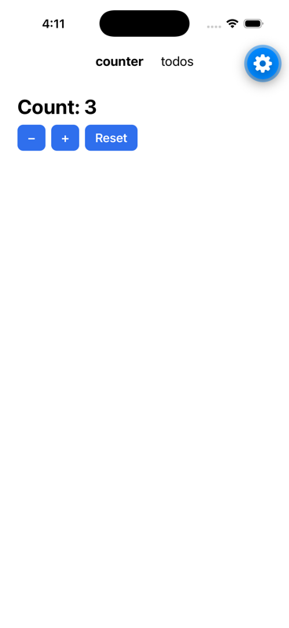
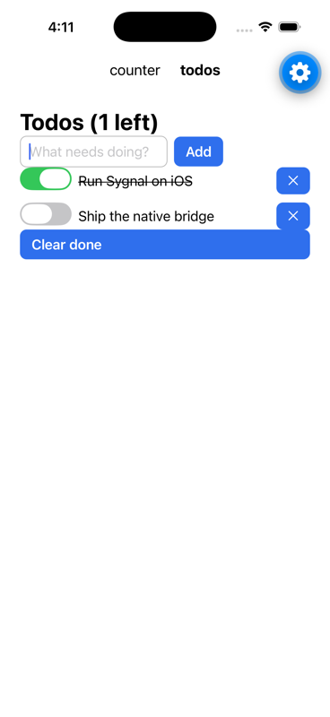
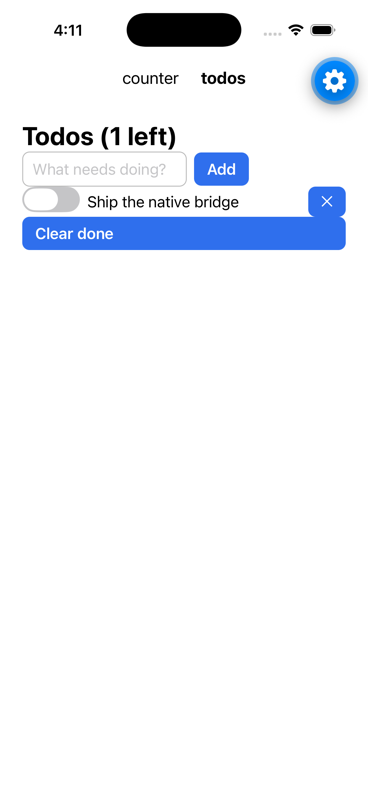

# Alternate renderers: Sygnal off the browser DOM

Research + spike, 2026-10-29, branch `claude/explore-alt-renderers-f380e8` (base `main` at 8605f1f7, sygnal 7.1.0).
This is research, not a plan of record. IDs used here (C1–C12 couplings, D-AR-n decisions) are local to this folder.

**Short answer.** Sygnal is unusually well placed for other renderers. The core (`src/core/`) has **no** DOM dependency of its own: it hands one snabbdom-shaped vnode per flush to whatever driver is named `DOM`, and it uses only five methods of that driver's source. The spike runs **examples/todomvc unchanged** (views, intents, models, Collection, Transition, refs, autoFocus, processForm) in a terminal. It changes **0 lines in `src/core`** and **1 line in `src/extra/processForm.ts`**, plus ~610 lines of renderer code (host tree, selectors, driver, terminal). A React host bridge (the shape a React Native target would take) works the same way with ~80 lines on top. The recommended direction is a **host-tree renderer kit** (`sygnal/host`): a tiny DOM-subset tree that snabbdom patches through a custom `DOMAPI`, plus a source that implements selectors and isolation over it. On that kit, add one first-party target, the terminal, and one documented bridge (React Native via React). Don't write a native reconciler.

## Round 2 (2026-10-29): built

The maintainer approved building the kit and two targets (coordinator decisions: Q2 yes, Q3 accept the field-tag registry, Q4 controls required in cross-platform docs only, Q5 DOM event names; Q1 React Native toolchain still pending). What landed on this branch:

| Piece | Where | What |
|---|---|---|
| `sygnal/host` | `src/host.ts`, `src/host/` (`dom.ts`, `driver.ts`, `selector.ts`, `style.ts`, `actions.ts`), `src/host.d.ts` | the kit: host tree, `makeHostDriver`, selectors (now with `^= $= *= ~=` and `:not()`), stylesheets, **user-agent actions** (`activate`, `pressKey`, `typeText`, `fill`, `chooseOption`, focus order), `registerFieldTags`, `nodeId`, `doc.listenedTypes(el)` |
| `sygnal/terminal` | `src/terminal.ts`, `src/terminal/paint.ts`, `src/terminal.d.ts` | `createTerminal`, `runTerminal` (raw TTY, alternate screen, scrolling to focus, resize, Ctrl+C), `paint` (line flow, wrapping, lists, widgets, ANSI), `parseKeys` |
| `sygnal/agent-ui` | `src/agent-ui.ts`, `src/agent-ui/` (`snapshot.ts`, `mcp.ts`), `src/agent-ui.d.ts` | the accessibility snapshot with refs and `[on=…]`, the `ui_*` tools, `runAgentUI`, `serveMcp` (MCP on stdio, both protocol eras), `agentTools(app)` served alongside, `chatTools()` |
| C10 fix | `src/pragma/index.ts` (`ce.$t = tags`, +12 B gz) | `registerFieldTags()` writes the pragma's field bit; host driver re-syncs those tags' value/checked |
| tests | `test/renderers-{host,terminal,agent-ui,entries}.test.js`, `type-tests/renderer-targets.ts` | 36 tests: todomvc unchanged on both targets, isolation, document listeners, patch errors, C10, painter, keys, `runTerminal` on fake streams, MCP both eras over streams, `agentTools` alongside, entry externals, plain-Node ESM + CJS loading |
| example | `examples/renderer-targets` | one grocery app: web (`npm run dev`), terminal (`npm run terminal`), MCP server (`npm run mcp`); 4 tests; strict-clean |
| docs | `docs/src/content/docs/renderers/` (overview, terminal, agent-ui, custom-targets), sidebar "Beyond the Browser", shipped in `dist/guide/renderers/` | includes the agent-UI definition and how a third party writes a target |

**"Agent UI" definition (D-AR-4).** A renderer target whose output is meant for a model: the accessibility snapshot format browser agents already read, and tools for a person's actions, turned into the same DOM events. Why this definition: agents already operate UIs this way; it needs no browser (text in and out, deterministic, cheap); Sygnal knows more than a browser (which elements intents listen to, `[on=dblclick]`, and when the app has settled, so every call answers with the post-action snapshot); and it uses the user's path, with no second API. It complements `sygnal/ai`'s agent declarations (semantic tools); one MCP server serves both. WebMCP (semantic tools in the user's tab) and MCP Apps (UI for a person inside a chat) are neighbours, not overlaps.

**Results.**
- Gates: `size-gate` 42,994 B / 43,000 B (6 B headroom; the `$t` hook costs ~12 B gz, everything else is behind the subpaths). `perf-gate --runs=3`: all metrics within limits (patches 1/1/1, streams 1.0, timers 2, retained 0, heap 0.91–0.92 MB). Full root vitest: 5,208 tests pass (final run); examples renderer-targets, todomvc, kanban pass; the round-1 spike (15 tests) still passes. `tsc` on src and type-tests: clean. `check-doc-samples`: 888 clean. Docs build + link check + code-title check: pass (a stale `docs/.astro` cache from the worktree's earlier use had to be removed first).
- No live demos were added to the docs (a terminal or an agent snapshot isn't something the live Result panel shows), so `check-live` wasn't needed.

**Decisions made in round 2 (mine).**
- D-AR-5: the targets render **HTML tags** (they understand form controls, lists, headings, links), so web views run unchanged; the neutral primitives (`View`, `Txt`, `Pressable`) are deferred to the React Native work, where a native vocabulary matters. `registerFieldTags` is there for targets that bring their own tags.
- D-AR-6: **interactive by intent**: the terminal's focus order and the agent's refs include elements the app's intents listen to clicks on (todomvc's `<label>` with a `dblclick` intent), via `doc.listenedTypes(el)`.
- D-AR-7: user-agent behaviour (click default actions, typing, Enter submits, label → control) lives in `sygnal/host`, shared by every target, so every target makes identical event sequences.
- D-AR-8: `makeHostDriver` installs a 16 ms `requestAnimationFrame` only where none exists (C9), rather than a core frame-scheduler change.
- The subpaths inline Sygnal's snabbdom modules (stateless) and keep `sygnal` / `sygnal/host` external (one core, one kit per app; `test/renderers-entries.test.js`).
- The MCP server is hand-rolled (as sygnal-check's and sygnal/vite's) to keep `sygnal` dependency-free.

**Still open.** React Native bridge (waiting on the toolchain, Q1); Lynx spike; worker/remote renderer (overlaps the contracts session); Portal on host targets (C8); a richer terminal layout (columns, flex rows) if users ask.

---

## Round 3 (2026-10-29): React Native on the iOS simulator

`rn-app/` is a hand-written Expo app (SDK 58: react-native 0.88.1, react 19.3.0), run in Expo Go on an iPhone 17 Pro simulator (iOS 26.3) with `npx expo start --ios`. It needs no CocoaPods: Expo Go hosts the JS bundle, and Metro serves `sygnal` from this repo through the `file:` link (`metro.config.js`).

| Counter: an HTML view, unchanged | Todos: shared logic, native view | after "Clear done" |
|---|---|---|
|  |  |  |

What the screenshots show, each driven on the simulator through Sygnal:

- **Counter.** Taps on the native `Pressable`s go `onPress` → `activate()` (a host `click`) → `DOM.click(Inc)` → the model, ending at "Count: 3" (+ + − + +). `src/counter.jsx` is plain HTML (`<section>`, `<h1>`, `<button>` controls). It's the component a web app would run, and the bridge maps the HTML tags onto RN components.
- **Todos.** Typed into a native `TextInput` (`onChangeText` → host `input` → `DOM.input(Draft).value()`), then Add (`DOM.click(Add)`). The Collection renders the new item. Flipping a `Switch` (`onValueChange` → host `click`, `input`, `change` → `DOM.change(Done)`) applies the line-through, and the calculated field updates the count to "1 left". "Clear done" removes the done item. The intent and model are in `src/todos.logic.js`, shared with any other view of the same controls.

**Bridge findings from the device run** (all fixed in `src/nativeHost.jsx`; the jsdom tests didn't catch them):

1. **Styles must be copied.** React freezes the style objects it renders (in dev), and snabbdom's style module mutates the host element's own `style` object on the next patch. Seen on iOS as "You attempted to set the key `textDecorationLine` … frozen". The bridge now passes `{ ...el.style }`.
2. **A controlled `TextInput` across an asynchronous round trip** (native text → `input` → Sygnal state → host patch → React render) gets values that lag the native text while typing fast, and rendering them reset the field mid-word. The bridge now treats a value the native side itself produced since the app last caught up as an echo: the native text stands, and any other value (the app clearing the field after Add) wins.
3. **A `toggle` isn't an `<input type=checkbox>`**, so `activate()` doesn't give it checkbox semantics. The bridge fires `click`, `input` and `change` itself.
4. **A host must stop painting before `dispose()`** empties the tree (`host.stop()`).

**Not bridge bugs, noted for whoever reruns this:**

- In the first session (Metro in CI mode, Expo Go's first launch), no taps reached Sygnal, and the plain React tab bar didn't respond either. After restarting Metro without CI mode and relaunching Expo Go, every press reached `onPress` and updated state. I didn't establish the cause.
- Injected simulator taps don't flip a native `UISwitch`, but a short horizontal swipe does. Two taps on the same spot in quick succession sometimes register once.
- With typing injected far faster than a person types (22 characters at once) and Add tapped about a second later, the item sometimes got a truncated title: the press was handled before the last keystrokes' updates. Logged `onChangeText` calls showed every keystroke arriving in order, and waiting 2 s before Add gave the full title. A production bridge should memoize per host element (it re-renders the whole tree per change, in dev mode here).

Verification: `npx vitest run --config dev-plans/research/alt-renderers/rn-app/vitest.config.mjs` (3 tests, jsdom with `react-native` stubbed) plus the simulator run above. To rerun: `npm install` and `npx expo start --ios` in `rn-app/`. `node_modules/`, `.expo/`, `ios/` and `android/` are gitignored; no `ios/` build was generated.

**Assessment.** The React Native path works: shared intent and model drive native views through `sygnal/host` with no change to the core or the component code, and an HTML view runs natively as is. The cost is a second tree (the host tree beside React's) and a whole-tree React render per change in this prototype. The work left before shipping a `sygnal/react-native`: per-element memoization, a real controlled-input protocol (event counts, as React Native's own `TextInput` uses), styles mapped from the host stylesheet, `Image` / `ScrollView` / list virtualization primitives, and a device build (`expo run:ios`, which needs CocoaPods).

---


Run it:

```bash
npx vitest run --config dev-plans/research/alt-renderers/spike/vitest.config.mjs      # 15 tests, ~2 s
node dev-plans/research/alt-renderers/spike/demo.mjs todomvc                            # interactive, in a TTY (also: tasks, counter)
node dev-plans/research/alt-renderers/spike/demo.mjs todomvc --script 'Ship it\r\t\t '  # scripted smoke run, prints the last frame
```

The spike imports `src/` directly (aliases in `spike/vitest.config.mjs` and `demo.mjs`), not `dist/`, so no build is needed and the processForm change is what runs.

---

## 1. How coupled is the core to snabbdom / the DOM?

### What the core actually requires (measured)

`src/core/runtime.ts` and `src/core/instance.ts` treat the driver named `DOM` as an opaque source with this contract (every call site listed):

| Use | Where | Contract |
|---|---|---|
| sink | `start()`: `app.proxies.DOM.imitate(app.vdom$)` | a stream of vnodes, **one per flush**. Fragments (Collection output, `<>`) are left for the driver to flatten (`flat()` in `cycle/dom/utils.ts`, which has no DOM in it) |
| `isolateSource(src, scope)` | `Inst.child()`, `Inst.src()` | returns a source scoped to a child (scopes are `'s1'`, `'s2'`, … from `App.scope()`: "total" isolation) |
| `isolateValue(vnode, scope)` (else `isolateSink`) | `App.scopeValue()` | stamps a child's vnode with its scope |
| `select(sel).events(type)` | `wrapDOM()` Proxy: `DOM.click(sel)` → `select(sel).events('click')` | the intent API. `sel` is a string or a control (stringifies to `[data-control="X"]`) |
| `dispose()` | `App.dispose()` | optional |

That's all. `MockedDOMSource` (renderComponent) already implements this contract with no DOM, so a second implementation was a known quantity. Reconciliation, element creation, hooks and events all live in the driver. **The vnode→host mapping is owned by the driver**, and events flow back the Cycle way: a driver-side delegator matches each host event against the selectors the intents opened, and pushes it into those streams. The core never sees a host node.

### Every DOM assumption, by layer

| # | Coupling | Layer | Severity for a non-DOM host | Spike outcome |
|---|---|---|---|---|
| C1 | vnodes are **snabbdom-shaped** (`sel` "tag#id.class", `data.{props,attrs,class,style,dataset,on,hook}`) | pragma → driver | none if the driver runs snabbdom (custom `DOMAPI`); a non-snabbdom host must interpret those buckets | reused snabbdom as is |
| C2 | the pragma's attribute routing knows HTML (ARIA, `for`, `form`, popover attrs → `attrs`; the rest → `props`) | `src/pragma` | low: unknown props land in `props` and the host gets them as element properties | fine |
| C3 | the pragma's **SVG tag table** includes `text`, so `<text>` goes to the SVG namespace | `src/pragma` | medium for an RN-style vocabulary (`<Text>` lowercased) | primitives use `txt` (D-AR-1) |
| C4 | hyphenated tags = custom elements (bit 8, `list` routing; the controlled-input module reads `elm.constructor.formAssociated`) | pragma, `controlledInputModule` | low | avoided hyphens |
| C5 | Sygnal's snabbdom modules (props, className, attrs, dataset, style, select, controlled-input) write **element properties** (`elm.value`, `elm.classList`, `setAttribute`, `elm.style`, `elm.dataset`) | `cycle/dom/modules` | none if the host implements that small surface | **all reused unchanged** on the host tree |
| C6 | event delegation, `matches()`, isolation by `IsolateModule` + `EventDelegator` | `cycle/dom` | high to reuse; low to re-implement | re-implemented: 83 lines of selectors + ~40 lines of delegation/isolation |
| C7 | `processForm` calls `new FormData(form)` (the DOM's) | `src/extra/processForm.ts` | blocks todomvc | **the one library change** (D-AR-2): `form.toFormData?.() ?? new FormData(form)` |
| C8 | `Portal` uses `document.querySelector` / `document.createElement` and a second snabbdom patch | `core/markers/portal.ts` | medium: Portal would need a host hook | not used (no portal in todomvc) |
| C9 | `autoFocus` and `Transition` use the global `requestAnimationFrame`; `Transition` uses `classList`, `parentNode`, `pokeDOM` (`new Event`, `dispatchEvent`) | pragma, `core/markers/transition.ts` | low | the terminal shims `requestAnimationFrame` with a timer; **Transition works** (the 300 ms leave keeps the item, with its classes, then removes it: asserted) |
| C10 | the pragma marks only `input/textarea/select` (and hyphenated tags) as **fields**, so a field vnode is never reused by identity (P46-P). A neutral `textinput` is "plain": a re-render with the same output (typed text, then state reset to the value rendered last) emits no patch, and the field keeps the typed text | `src/pragma` (`FIELD`) | medium: wrong value shown in a reset-after-type flow | **reproduced** in `primitives.test.tsx` ("GAP: …"); fix = a host field-tag registry in the pragma (open question Q3) |
| C11 | `run()` builds the default DOM driver eagerly even when `drivers.DOM` replaces it (`makeDOMDriver('#root')` is called; harmless in Node because the DOM lookup is lazy) | `core/runtime.ts` | none | noted |
| C12 | DOM-only extras: `sygnal/ui` (native `<dialog>`, popover, toaster), `makeBrowserDriver`, view transitions, `processDrag`, `createRef` typing (`HTMLElement`), `sygnal/element`, SSR (its own vnode walker, `extra/ssr.ts`) | extras | expected: these are web features | out of scope; per-platform equivalents would be drivers |

Diagnostics: the dev checks (SYG103/104 selector checks, `next.ts`) work on vnodes and the source facade, so they aren't tied to the DOM. The one exception is `checks/shorthand.ts`, which validates `DOM.<event>` names against `HTMLElement.prototype`, so a platform event name (`DOM.press`) would warn. That's another reason to keep DOM event names (D-AR-3). The spike didn't run the dev entry.

### What a renderer driver interface looks like

The spike settles it as **two layers**, both small:

```ts
// 1. A host tree: the DOM subset Sygnal's modules, refs, Transition and processForm touch
//    (spike/host.ts, ~220 lines). snabbdom patches it through a custom DOMAPI (hostApi).
interface HostElement {
  localName; tagName; parentNode; childNodes; firstChild; nextSibling
  setAttribute/getAttribute/removeAttribute/hasAttribute; className; classList; style; dataset; id
  value; checked; type; name; placeholder; disabled          // form state the platform edits
  insertBefore/appendChild/removeChild; matches/closest/querySelector(All)
  addEventListener/removeEventListener/dispatchEvent(bubbling); focus/blur
  toFormData?()                                             // D-AR-2
}

// 2. The driver: snabbdom over the host + the source contract above (spike/hostDriver.ts, ~130 lines)
makeHostDriver(doc: HostDocument, {onPatch}) → (vnode$) => HostSource
HostSource: select(sel) · events(type) (enriched: .value() .checked() .key() …) ·
            isolateSource · isolateValue/isolateSink (cycle/dom/isolate.ts, reused) · elements()/element()
```

A **platform** is then just whatever reads the host tree and writes events into it. The terminal (`spike/terminal.ts`, ~150 lines) does layout + paint + focus ring + key→event translation. The React bridge (`spike/reactBridge.ts`, ~80 lines) turns the host tree into React elements on each commit and wires native callbacks to `dispatchEvent`.

Why a host tree rather than a "vnode → native ops" interpreter (decision D-AR-0):
- snabbdom's keyed diff, the hooks (refs, autoFocus, Transition, widgets) and Sygnal's own modules are reused **as they are**. Replacing them would mean re-implementing snabbdom's patch (~375 lines) and Sygnal's modules (~390 lines) of tested behaviour (B-012, B-015, G-109, G-553 …).
- Selectors, isolation scopes and `closest()` need a parent-linked tree anyway.
- It's the strategy that already ships elsewhere: NativeScript's DOMiNATIVE/undom-ng give Vue 3, Solid and Svelte a minimal DOM over native views ([dominative on npm](https://www.npmjs.com/package/dominative), [NativeScript community Vue](https://github.com/nativescript-community/vue)). Lynx's Element PAPI is an imperative element-tree API too, and its "vanilla Lynx" pattern builds the tree on the main thread and sends patches from a background thread ([vanilla-lynx skill](https://www.skills.sh/lynx-community/skills/vanilla-lynx), [Lynx test environment](https://lynxjs.org/api/lynx-test-environment)).
- The cost is a retained tree in JS. For React Native that's a second tree next to React's (§4 numbers).

---

## 2. Candidate targets

Scored 1–5 (5 = best; for maintenance cost, 5 = cheapest). Feasibility means what the spike showed or what the architecture makes likely.

| Target | Feasibility | Value | Maint. cost | Notes | Verdict |
|---|---|---|---|---|---|
| **Terminal UI** (own painter on the host tree; later a Yoga/OpenTUI-backed layout) | **5** (done: todomvc unchanged) | 3: CLI tools, **agent UIs** (sygnal/ai's chat driver + an agent in a terminal), dev tools; a niche, but a real one | 4: no native toolchain; layout is the open-ended part | OpenTUI shows the market (Zig core with React and Solid reconcilers, powers OpenCode, [overview](https://blog.openreplay.com/opentui-alternative-ink/), [Solid binding](https://www.mintlify.com/anomalyco/opentui/integrations/solid)). Its core "Renderables" are an imperative tree, the same shape as the host tree | **Build** (first-party, small) |
| **React Native via a React bridge** (host tree → React elements of RN host components) | 4: the bridge is proven with react-dom; RN itself not run (no toolchain here) | 5: iOS/Android with the largest native ecosystem; Sygnal apps stay MVI | 3: tracks RN's component props, but not its internals | RN has no stable public host API without React (Fabric's UIManager is internal), so a reconciler-free path would chase private APIs. The bridge rides React's public surface. Double tree; React does the native diff | **Prototype on device next** (needs RN toolchain: maintainer's call) |
| **Lynx** (host tree → Element PAPI on the main thread, or op log from a background thread) | 3: the API shape fits snabbdom's `DOMAPI` almost 1:1; untested | 4: native + web from one tree, dual-thread by design | 3: a young but framework-neutral API (the docs ship a pure-JS PAPI test env for Node) | The best "native via JS" fit architecturally; Miso (Haskell) already targets it ([Miso Lynx](https://lynx-haddocks.haskell-miso.org/miso-lynx/Miso-Lynx-Element.html)), which shows non-React frameworks can | **Next spike** after the kit (can be done in Node with `@lynx-js/test-environment`, no native SDK) |
| **NativeScript** (DOMiNATIVE as the host) | 4: DOMiNATIVE *is* a DOM-subset host, so `makeDOMDriver` might run on it nearly as is | 3: native views, smaller ecosystem than RN | 3: DOMiNATIVE is at 0.1.3 with "little ongoing maintenance" (its own words) | Cheapest native path to try; the risk is depending on a quiet package | Try only if a user asks |
| **Worker / remote renderer** (the app in a Web Worker or on a server; the host tree's mutations serialized as an op log to a thin applier) | 4: the host tree is already the op source (every mutation goes through 6 methods) | 4: main-thread relief, Lynx-style dual thread on the web, **server-driven UI** for agents | 3 | A creative fit for MVI: intents only need events (serializable: type, target id, value), not DOM objects. Overlaps the "front/back-end contracts" exploration | **Worth a spike** (shared with the contracts session) |
| **Canvas / WebGL** (host tree + Yoga/Taffy layout + a painter, or a Pixi scene graph as the host) | 3 | 2–3: games, dense visualisations; a canvas loses accessibility and text input | 2: layout, text and hit-testing are the whole job | Doable on the kit, but the value is mostly in the painter, not in Sygnal | Skip unless a concrete user appears |
| **Valdi** (Snap) | 1 | 3 | 1 | Compiles its own TypeScript component model to native at build time with Bazel ([repo](https://github.com/snapchat/valdi), [The New Stack](https://thenewstack.io/snapchat-open-sources-cross-platform-ui-framework/)). There's no runtime host API to drive, and it's beta | **Skip** |
| **Server / string rendering** | 5 (exists: `extra/ssr.ts`, Astro, Vike) | already shipped | — | SSR walks vnodes with its own walker, not the core. A host-tree serializer could replace it later, but there's no pressing reason | Nothing to do |
| **JSON UI targets** (Slack Block Kit, Adaptive Cards, MCP Apps / agent "generative UI" schemas) | 4: the host tree → JSON is trivial, and actions come back as events | 3: fits sygnal/ai and the MCP App work | 4 | One-way-ish and schema-bound; best as a *driver* per schema, not a renderer kit feature | Note for the AI roadmap |

**Picked and prototyped:** the terminal (full) and the React host bridge (as the React Native stand-in, verified on react-dom). Lynx is the recommended third.

---

## 3. Cross-platform consistency

### The primitive set (spike/primitives.ts)

A neutral vocabulary that each platform maps. Interactive ones are **control specs**, so intents select them by identity, not by CSS (`controls({Add: Pressable})`, `DOM.click(Add)`):

| Primitive | web (`mapTags` driver wrapper) | terminal | React Native (`nativeTable`, not run) |
|---|---|---|---|
| `View` | div | block | View |
| `Row` | div (flex row) | block, inline children | View `flexDirection: 'row'` |
| `Txt` | span | text | Text |
| `Pressable` | button type=button | `[label]`, Enter/Space | Pressable (onPress → `click`) |
| `TextInput` | input | `[value_]`, typing | TextInput (onChangeText → `input`, onSubmitEditing → `keydown` Enter) |
| `Toggle` | input type=checkbox | `[x]`/`[ ]` | Switch (onValueChange → `click` + `change`) |

Decisions made in the spike:
- **D-AR-1**: tag names are `view`, `row`, `txt`, `pressable`, `textinput`, `toggle`. `text` is taken by the pragma's SVG table (C3), and a hyphenated tag is a custom element to the pragma (C4).
- **D-AR-3**: **the DOM's event names and shapes are the cross-platform event contract** (`click`, `input`, `change`, `keydown`, `focus`/`blur`; `e.target.value`, `e.target.checked`, `e.key`). Each platform translates its native events into them, so `.value()`, `.checked()`, `.key()`, `processForm`, the shorthand check and todomvc's `inputEvents` helper work everywhere. The alternative (platform names like `press`) would fork every intent.
- Mapping happens **in the driver, before the patch** (`mapTags`, memoized per vnode, so unchanged subtrees keep identity and snabbdom still skips them). Components never branch on the platform.

### Shared intent/model, per-platform views

`app/tasks.logic.ts` holds the state, model, intent, calculated fields and the controls. `app/tasks.web.tsx` and `app/tasks.tui.tsx` are two different layouts (the terminal one drops the Add button for Enter, reorders, adds key hints). `withView(logic, view)` attaches the logic: a Sygnal component is a function plus statics, so swapping the function swaps the view and keeps everything else. `app/counter.tsx` goes the other way: one view for all three targets.

Tested (`primitives.test.tsx`, `reactBridge.test.tsx`): Counter on jsdom's real DOM driver, the terminal, React DOM and renderComponent. Tasks with the web view on the DOM and on React, the terminal view on the terminal, and both views under renderComponent with **the same test body**.

### Is MVI a real advantage over React here? (an honest look)

Where it holds:
- **The logic is data, not a hook-laden function.** In React, the state machine of a screen lives inside the component (`useState`, `useEffect`, handlers closed over in JSX). Sharing it across a web view and a native view means pulling it into custom hooks by hand, and the handlers stay bound to JSX props (`onClick` vs `onPress`). In Sygnal, intent and model are already separate statics with no view in them. `withView` is one line, and the spike's Tasks logic runs under two views and three renderers without a single platform check.
- **Events are a selector contract, not callbacks.** Because the view doesn't bind handlers (an existing design decision: no event binding in views), the platform only has to produce events that match selectors. The renderer owns event translation completely. That's why todomvc ran in a terminal unmodified: nothing in its views says "onClick".
- **Testing is renderer-free by construction.** renderComponent's mock DOM tests intents and models with no renderer at all, and the same test covers every platform's view that uses the same controls.

Where it doesn't, or is weaker than it looks:
- **CSS-selector intents leak web structure.** todomvc's intents (`'.todo label'`, `'.new-todo-form'`) only ran in the terminal because the terminal honours classes and descendant selectors on the host tree. A platform view with a different structure breaks such selectors silently. **Controls** fix this (identity, not structure) and are what the cross-platform guidance should require. That's a canonical-forms change for cross-platform code, not for the web.
- **Effects that touch hosts aren't portable.** todomvc's `NEW_TODO` EFFECT writes `newTodoRef.current.value = ''`. It worked because the host element has a `value`, but on React Native a ref is a native component instance, and the effect would need a driver command instead (`ELEMENT` commands / widget commands already exist for this).
- **React Native's own ecosystem is React components.** A Sygnal app on RN gets RN's host components (through the bridge) but not RN's library ecosystem written as React components without wrappers. `sygnal/react`'s `fromReact()` already embeds React components on the web, and the same idea would apply on native, with an extra wrapper per component.
- **Styling and layout remain per platform.** That's true for React Native Web too. The spike keeps styling in the renderer (a terminal stylesheet for todomvc's CSS), which is honest but means "consistent experience" is still a design-system job, not something the framework gives for free.

Net: the claim holds for **logic reuse and testing** and is a genuine differentiator. It doesn't hold for styling or ecosystem, and it depends on **controls instead of CSS selectors** for intents.

### sygnal-check across platforms (run on `spike/app`)

- **False positive**: capitalized primitives (`<View>`, `<Row>`) are taken for components, so `DOM.click(Inc)` inside them gets **SYG104** ("only rendered inside child component <View>") on `counter.tsx`. The checker needs to know primitives/controls rendered via `__sygnalControl` aren't components (a config list or detection of `primitive()` / `controls()` imports).
- **Blind spot**: statics attached with `withView(logic, view)` (an `Object.assign` of an imported object) aren't linked to the view, so Tasks' intents went unchecked. Either the checker follows `withView`/`Object.assign`, or the canonical form for shared logic becomes `View.intent = Logic.intent` assignments, which it already reads.

---

## 4. The spike: what changed, what it measured

Files (`dev-plans/research/alt-renderers/spike/`, 1,231 lines including tests):

| File | Lines | What |
|---|---|---|
| `host.ts` | 224 | HostDocument / HostElement / HostText / HostEvent + snabbdom `DOMAPI` |
| `selector.ts` | 83 | the CSS subset intents use (descendant, `>`, tag, #id, .class, [attr], [attr=v], :focus) |
| `hostDriver.ts` | 131 | the renderer driver: snabbdom + Sygnal's modules + scope module + field re-sync; HostSource |
| `terminal.ts` | 146 | layout/paint, focus ring, keys → DOM-shaped events, link/label/checkbox/submit default actions, stylesheet |
| `primitives.ts` | 78 | the primitives, control specs, web tag table, `mapTags` driver wrapper |
| `reactBridge.ts` | 81 | host tree → React elements; react-dom table; React Native table (illustrative) |
| `drivers.ts` | 27 | in-memory STORE / ROUTER with todomvc's source shapes |
| `app/*` | 123 | Counter (one view), Tasks (shared logic + web and terminal views) |
| `*.test.*` | 338 | experiments A (todomvc), B (primitives), C (React), bench |
| `demo.mjs`, `demo-entry.tsx` | | the interactive TTY demo |

**Library changes: one line** (`src/extra/processForm.ts`: `typeof formEl.toFormData == 'function' ? formEl.toFormData() : new FormData(formEl)`). **`src/core`: none. `src/pragma`: none** (C10 is documented, not fixed). Not covered by the library suites here: they import `dist/`, which wasn't rebuilt, to avoid loading the shared machine. The change only takes effect for a form that has `toFormData`.

What experiment A exercised in todomvc, unchanged: keyed Collection with per-item total isolation (a click on an item's `.toggle` doesn't reach the root's `.toggle-all`: asserted), `processForm` submit, a ref written from an EFFECT, `autoFocus={editing}` moving focus into the edit field after a `dblclick`, `blur`/`keydown` Enter/Escape editing flows, `Transition` enter/leave with its 300 ms leave, a link activation → the ROUTER driver → filter, `STORE` writes.

Cost (bench.test.ts, todomvc with 1,000 todos, Node 3 runs, jsdom for the DOM driver; jsdom isn't a browser, so this only shows the host path isn't a bottleneck):

| | start → first patch | toggle-all → patched | full text frame |
|---|---|---|---|
| jsdom + makeDOMDriver | 160–205 ms | 36–48 ms | — |
| terminal host tree | 23–27 ms | 14–55 ms | 17–22 ms (unoptimized: every rule matched per node) |

Known spike limitations: the terminal's layout is a line flow (no columns, no wrapping, no scrolling). Its repaint is the whole frame. Portal, `sygnal/ui`, `VirtualCollection` (needs measurement) and widgets weren't tried. The React bridge re-renders the whole host tree per commit (React diffs it; a production bridge would memoize per host element by a version counter). React Native wasn't run.

---

## 5. Recommended direction

Worth pursuing, in this order, each step small and reversible:

1. **`sygnal/host`: the renderer kit** (≈450 lines from the spike's host + selector + hostDriver), as a public subpath with its own tests and docs page. The library side is small:
   - D-AR-2's `toFormData` hook in processForm (done in the spike);
   - a **host field-tag registry** in the pragma, fixing C10 (`registerFieldTags(['textinput', 'toggle'])` or a driver-declared list), and the same list for `controlledInputModule`;
   - a `requestAnimationFrame` indirection for `autoFocus`/`Transition` (a driver-provided frame scheduler, C9);
   - a Portal host hook (C8), when a target needs it;
   - don't build the default DOM driver when `drivers.DOM` is given (C11).
2. **Primitives + controls as the cross-platform canonical form** (`View`, `Row`, `Txt`, `Pressable`, `TextInput`, `Toggle`, plus `Image`, `ScrollView`, `List` later). sygnal-check learns them (the SYG104 false positive) and follows `withView` (or the docs use explicit static assignment). renderComponent already works.
3. **`sygnal/terminal`** as the first first-party target: the spike's painter, replaced by a real layout (Yoga via wasm is a regular dependency; OpenTUI's core is the alternative if a native FFI dependency is acceptable, D209). Pitch: "build your agent's TUI with the same components as its web UI" (sygnal/ai).
4. **React Native bridge**: run the spike's `nativeTable` in an Expo app on a simulator. If it holds, ship it as `sygnal/react-native` (optional peer deps `react`, `react-native`) with the primitives' RN table, memoized per host element.
5. **Lynx spike** in Node against `@lynx-js/test-environment` (no native SDK), then on device.
6. **Worker/remote renderer**: serialize host-tree mutations and events. Coordinate with the front/back-end contracts session.

Rough size: steps 1–2 are a PLAN-sized effort with the existing gates (unit, types, size gate: the kit is a separate subpath, so the core budget isn't touched). Step 3 is mostly layout work, and step 4 is mostly device testing.

Not recommended: a reconciler-free React Native path on Fabric internals, Valdi, canvas as a first-party target, or a vnode-interpreter driver that bypasses snabbdom.

---

## 6. Open questions (for the maintainer)

- **Q1. Toolchain**: may a follow-up install the React Native / Expo toolchain and use the iOS simulator (Xcode components, large download) to run step 4? Nothing was installed for this spike.
- **Q2. Positioning**: is "Sygnal for TUIs / agent UIs" a direction you want (step 3), or should the kit stay an extension point for others?
- **Q3. Pragma change**: the C10 fix touches the pragma's hot path (`FIELD` / `tagBits`). A registry adds a lookup on a cached path. Accept it, or keep neutral tags out of the pragma and require platforms to map to `input` before the core (impossible: the core's identity reuse happens first)?
- **Q4. Canonical forms**: should cross-platform code *require* controls (no CSS selectors in intents)? Recommended for cross-platform docs only. Web docs stay as they are.
- **Q5. Event contract**: confirm D-AR-3 (DOM event names everywhere) before any public API. It shapes every platform table.
