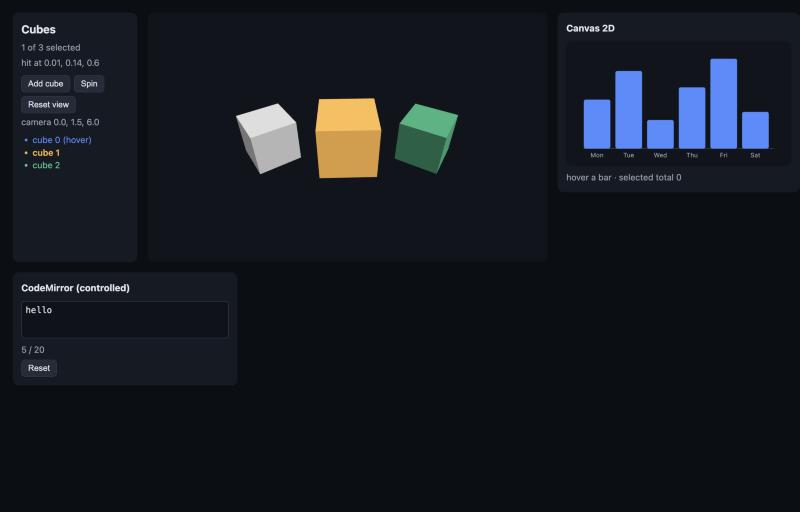
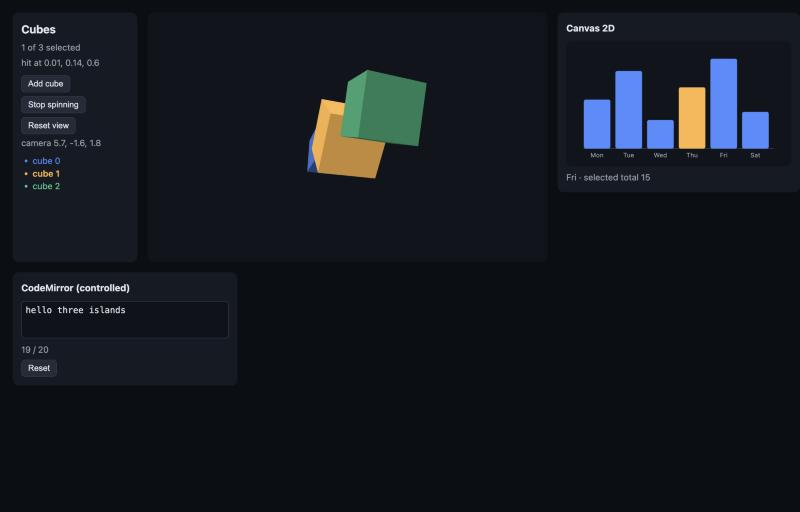
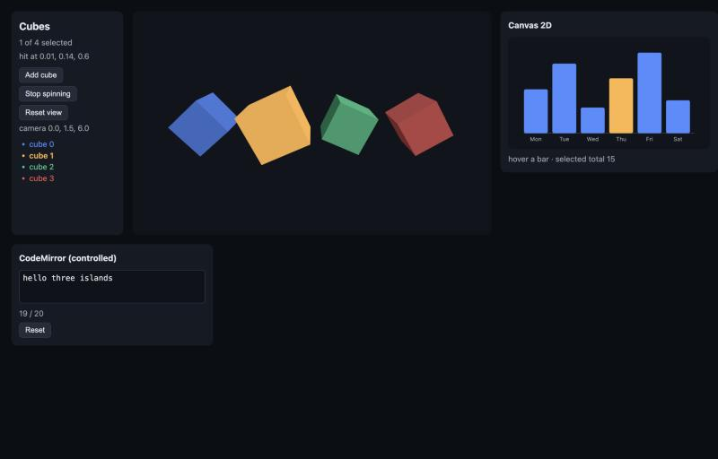
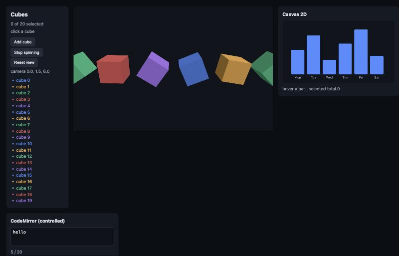
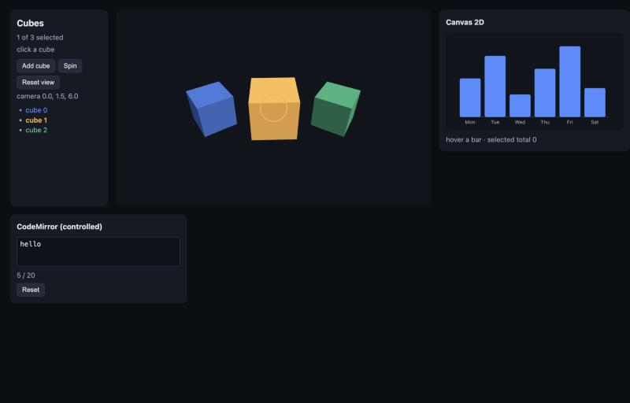

# Imperative islands: three.js, canvas, editors and maps in a Sygnal app

Research + prototypes, 2026-10-29, branch `claude/explore-canvas-three-44eb10` (cut from `claude/advanced-integration` at ff4ef64c, sygnal 7.2.0-preview.0).
This is research, not a plan of record. IDs here (O1–O5 options, D-CT-n decisions, Q-n questions) are local to this folder.

**Short answer.** Sygnal doesn't need a second renderer to host a WebGL scene or a canvas. It needs one idea: **the DOM is the island's scene graph.** An island tag (`<Scene>`, `<Canvas2D>`, `<Editor>`) renders its JSX children through the app's own DOM driver into a hidden container: `<mesh>` is an `HTMLUnknownElement`, `<rect>` an `SVGRectElement`. The island then paints that subtree its own way (three.js objects, canvas draw calls) and turns raycasts or hit tests into ordinary DOM events on those elements. Because the children are plain elements in the one vnode tree, everything Sygnal already has works inside the island unchanged: components with their own intent and model, `Collection`, isolation, context, `DOM.click('.cube')`, `renderComponent`, and the agent snapshot.

- **0 bytes in the core.** No core hook, no Portal change, no second driver. The island is a control render hook (CT-1, as `defineWidget` uses) plus snabbdom hooks.
- **The same three target runs on `sygnal/host`.** A whole app can be a scene: Node tests, a game, the agent UI, with no DOM and no WebGL.
- **The frame loop stays out of MVI.** `animate={{ rotation: t => … }}` props are evaluated by the target per frame. Measured: **0 patches, 0 renders, 0 island syncs per frame**, against 1 patch and 101 renders per frame when the angle goes through state.
- **One protocol for two-way values** (camera, editor text, map viewport): `controlled()`. It skips echoes, late ones included, writes only when the app changes the prop, and can optionally revert edits the model rejected. It's prototyped on CodeMirror 6 and on an OrbitControls camera.



| orbit, spin, chart, editor | reset view + add cube | 20 cubes spinning (0 app work per frame) |
|---|---|---|
|  |  |  |

Each screenshot is real mouse input in Chromium (the desktop app's browser pane), WebGL on. Click a cube: a raycast, then `DOM.click('.cube')` in that cube's own intent, so it scales and glows, and the hit point reaches state. Hover turns a cube white. Dragging orbits the camera: the gesture's end becomes a `camerachange` event and state, and "Reset view" writes it back. Spin runs `animate`. The bars are `<rect>` children of a canvas, with hit tests becoming `click`/`pointerover` events. CodeMirror is a controlled value, clamped by the model to 20 characters.

Run it:

```bash
cd dev-plans/research/canvas-three && npm install     # three 0.186.1, @codemirror/state + view (24 MB, gitignored)
npx vitest run --config vitest.config.mjs               # 17 tests, ~2 s: jsdom + Node, no WebGL
npm run dev                                             # bundles src/ for the browser (build-demo.mjs), then Vite on index.html
```

The tests import `src/` directly (aliases in `vitest.config.mjs`, as the alt-renderers spike does), so no build is needed. The browser demo bundles `src/` once with esbuild (`build-demo.mjs`). Vite serves `src/` file by file, and `src/cycle/dom/index.ts` re-exports types as values (`Thunk`, `VNode`), which the browser rejects.

---

## Round 2 (2026-10-29): built into `src/`

The coordinator accepted the design (Q1–Q5, under the maintainer's delegation). What landed on this branch, after merging `claude/advanced-integration`:

| Piece | Where | What |
|---|---|---|
| Islands in `defineWidget` (Q1) | `src/extra/widget.ts` | `children: true \| 'hidden'`: the marker keeps its JSX children, the host gets a `[data-widget-children]` container with them (walked by the core, so components and Collection work inside); `sync(instance, childrenVnode, host)` after mount and after a patch whose children vnodes changed (identity); `focus(instance, child \| null)`; `tags` clears the pragma's SVG bit for the widget's vocabulary (F3, 0 B in the pragma: it writes the existing `$t` table); SSR renders the children too |
| Accessible children (Q4) | same | visually hidden (the sr-only clip), not `hidden`; Enter / Space on a focused non-native child dispatches its `click`; `children: 'hidden'` opts out |
| Controlled value (Q3) | `src/extra/controlled.ts`, `widget.ts` | `value: { write, read?, equals?, event?, strict? }`: the `value` prop goes through `controlled()` (echoes skipped, app changes written once, `strict` reverts an `ABORT`ed edit a macrotask later); `read` defines the host's `value` (`.value()` in intents); `update` isn't called for `value` alone. Experimental |
| Q2 | (no code) | raycast events follow DOM rules, as the prototype already did |
| Q5 `frame` | **not built** (my decision, see below) | the `timers` static already has `{ frame: 'ACTION' }` |
| F1 | `src/agent-ui/snapshot.ts` | a role-less listened element is a leaf only when nothing interactive is inside it |
| F2 | `src/core/instance.ts` (`inject`) | a template node's last injected copy is kept (`ic`, a WeakMap per instance) and reused when its injected children are the same objects |
| F3 | `widget.ts` `tags` | as above. Scoping SVG routing to `<svg>` ancestors was not possible: a component's output is made before it is placed, so the pragma can't see its ancestors |
| SVG props bug | `src/pragma/index.ts` (`applySvg`) | found while wrapping canvas children in `<svg>`: a component placeholder or marker (`<Collection>`) under a literal `<svg>` had its props moved to attrs, so the component got none. Now skipped |
| F4 | `src/cycle/dom/index.ts` | `export type` for the type re-exports (`tsc --isolatedModules`: 0 errors); the research demo now serves `src/` through Vite directly |
| Types | `src/index.d.ts`, `type-tests/islands.tsx` | `children`, `sync`, `focus`, `tags`, `value` (`event: NoInfer<EV>`); the widget tag accepts children |
| Tests | `test/islands-widgets.test.js` (12) | children with components / Collection / isolation, the sync skip, keyboard and focus, `'hidden'`, SSR, `tags`, `value` (echoes, app writes, clamp, strict), F2 (fails without the fix), agent-ui F1, components under `<svg>` (fails without the fix) |
| Docs | `guide/islands.md` (new; live canvas and CodeMirror demos, a three.js recipe), `guide/widgets.md` (children, controlled values), `reference/api.md`, `recipes/code-editor.md`, `llms.txt`, the skill, CHANGELOG | |
| Prototypes | `lib/Scene.ts`, `lib/Canvas2D.ts`, `lib/Editor.ts` | now `defineWidget` from `src/` (`lib/island.ts` is only `islandOf`); the three.js scene has keyboard focus (Tab, Enter, a projected ring) and the chart's bars are focusable SVG in an `<svg>` |

**Decision I made (Q5 reversed).** The round-1 report said Sygnal had no frame source; that was wrong. `makeTimerDriver`'s `timers` static has had `{ frame: 'ACTION' }` (data `{ t, dt }` in ms, `requestAnimationFrame` with a 16 ms fallback, fake timers drive it) since PLAN-4. A `frame` kind in the `browser` static would have been a second API for the same thing with other units, so I built it, then removed it before committing the docs; the islands guide points at the `frame` timer. The research's `lib/frame.ts` stays as the measurement harness.

**Verified in Chromium** (the desktop app's browser pane, WebGL on), against `src/`: Tab from "Reset view" reaches the cubes, Enter selects one, the focus ring is drawn where the cube is, and the browser's accessibility tree lists `button "cube 0"` … `button "cube 1 (selected)"`; the canvas bars are `button "Thu: 15"` etc., Enter toggles a focused bar and its ring is drawn on the canvas.



## 1. Prior art

| Library | How the tree is built | Events | Frame loop | Props / children | Two-way values |
|---|---|---|---|---|---|
| **react-three-fiber** (pmndrs) | a React reconciler (`react-reconciler`) creating THREE objects; a catalog of THREE classes, `extend()` for more | `onClick`, `onPointerOver`… from raycasts; propagation through **every** intersection, nearest first, until `stopPropagation()`; `onPointerMissed` | `useFrame(cb)` mutates refs outside React rendering ("never setState in useFrame"); `frameloop: 'always' \| 'demand' \| 'never'`, `invalidate()` | `args` (constructor args; a change recreates), `attach` (geometry, material, or any key), dash piercing (`material-color`), arrays → `.set(...)`; auto-dispose on unmount, `dispose={null}` opts out | uncontrolled: OrbitControls (drei) own the camera; you read refs |
| **threlte** (Svelte) | `<T.Mesh>` (a `T` proxy over THREE), Svelte components | opt-in `interactivity()` plugin, the same raycast model | `useTask` (ordered tasks, stages) | `args`, `attach`, `bind:ref` | Svelte `bind:` on props (two-way by construction) |
| **TresJS** (Vue) | a Vue custom renderer (`createRenderer`), `<TresMesh>` | `@click` and friends via raycasting | `useLoop` / `onBeforeRender` | as r3f | `v-model`-style through composables |
| **solid-three** | Solid's universal renderer | as r3f | `useFrame` | as r3f | Solid signals |
| **react-konva** | a React reconciler for Konva's 2D scene graph (`<Stage><Layer><Rect/>`) | Konva's own hit testing (a hidden hit canvas, one color per shape) → `onClick` | Konva animations; React re-renders for state | props → node attrs | the known problem: a dragged node and React's props disagree after the drag. react-konva's **strict mode** re-applies all props each render. Default mode only applies changed props, so the drag "wins" |
| **react-leaflet** | components that create Leaflet layers in effects; `<Marker>`, `<Popup>` as children of `<MapContainer>` | Leaflet events via `eventHandlers={{ click }}` | n/a | children → layers via context | **`MapContainer`'s props are immutable after mount**: changing `center`/`zoom` does nothing; you call `useMap().setView()` yourself. The controlled viewport is left to the user |
| **A-Frame** | **custom elements as the scene graph** (`<a-entity>`), entity-component system | DOM events on the elements (the cursor component raycasts) | `tick` per component | attributes parsed by components | DOM attributes |

What this says for Sygnal:
- The props conventions are settled. `args` recreates, `attach`, arrays to `.set()`, dispose on unmount, `dispose={null}` opts out, and a THREE catalog with `extend()`. The prototype follows r3f here. There's no reason to differ.
- Every framework keeps per-frame work **out of its render cycle** (`useFrame` mutating refs, `useTask`). The MVI equivalent is a declarative per-frame function, not a frame action (§4).
- **A-Frame is the precedent for O1**: DOM elements as the scene graph, DOM events on them. Its known cost is DOM overhead per entity; §3 measures it for this design.
- Two-way values are the weak spot everywhere. React's world needs strict modes and imperative escape hatches; react-leaflet gave up on controlled viewports. Svelte and Vue get two-way binding from the language. §6 proposes Sygnal's protocol.

---

## 2. The second renderer inside a DOM app (C8): options

| Option | What | Core bytes | Components / Collection inside | Intents, isolation | Tests without WebGL | Cost |
|---|---|---|---|---|---|---|
| **O1. DOM-resident children (the island)** | the island's JSX children are ordinary elements in a hidden container; the island paints them and dispatches DOM events on them | **0** | **yes** (the core walks them like any children) | **unchanged**: `DOM.click('.cube')`, per-item scopes | mock DOM (selectors), jsdom (raycasts), host | one DOM element per object (§3: 1,000 cubes mount in 66–77 ms in jsdom) |
| O2. Nested host driver (Portal-style) | the island patches its children into a `HostDocument` with a second snabbdom patch, as Portal does into `document` | 0–200 B (a Portal host hook) | **no**: Portal content isn't walked, so components inside aren't instantiated (`core/markers/portal.ts`) | a second source (`SCENE.click`); no isolation | host | a second patch per change |
| O3. A core multi-root (per-subtree drivers) | the core splits its vnode output by region, each region its own driver and sources | 400–800 B (most of the 587 B headroom) | yes | intents name the region's driver | host | core complexity in the hot path |
| O4. `defineWidget` props only (today) | the scene is one opaque widget; objects come in as data props | 0 | no: data, not components | one event surface on the host | needs the widget's own fakes | per-object intents and models are lost |
| O5. A three target for the whole app only | `run(App, { DOM: threeDriver })` | 0 | yes | yes | yes | no DOM UI around the scene |

**Recommended: O1** (D-CT-1). O5 comes for free on the same target code (`lib/threeHost.ts`).

Why O1 needs no core hook: it isn't a second renderer. The DOM driver stays the one renderer of the vnode tree, and the island is a second **painter** of a DOM subtree. That's the same split `sygnal/host` makes between the host driver and a target. The C8 Portal gap stays open, but islands don't need Portal.

How it works (`lib/island.ts`, 96 lines, 737 B gzip):
- The tag carries `__sygnalControl` (the pragma's CT-1 render hook), so it's never instantiated as a component. It returns `div[data-island-host] > div[hidden][data-island] > children`, with the island's props in `data.ip` and a key of its own.
- `insert` mounts the library into the host element and syncs. `postpatch` calls `update` when the island's props change (shallowly) and `sync` when the children changed.
- `sync(instance, childrenVnode)` gets the **patched vnodes**: each element's props as the view wrote them (arrays, functions, objects), with `.elm` set. Reading props back from elements would need to know which expandos are props.
- **Measured fix (D-CT-2):** the island's own vnode is a new object whenever its owner re-injects any child (finding F2), so `postpatch` fires even when nothing inside the island changed. The island compares its children vnodes by identity (they're cached per component) and skips the sync. In the HUD case (A2 in §4), per-frame cost fell from 0.228 ms to 0.068 ms.

---

## 3. three.js on the island and on `sygnal/host`

`lib/three.ts` (226 lines, 2.1 KB gzip without three) maps a patched element tree to THREE objects. Decisions (D-CT-3):

| Topic | Decision |
|---|---|
| Tags | any THREE export, lowercased (`<mesh>`, `<boxGeometry>`, `<meshStandardMaterial>`, `<perspectiveCamera>`, `<directionalLight>`); `extend({ OrbitControls })` adds more. **An unknown tag is transparent**: a component's wrapper `<div>`, a Collection, a HUD `<p>` pass their children to the nearest object above |
| Transforms | `position`, `rotation`, `scale`, any `.set`-able value: an array → `.set(...)`, a number → `.setScalar`, a string → `Color.set`, a same-class object → `.copy` |
| Methods | a prop naming a method is called: `lookAt={[0, 0, 0]}` |
| Other props | assigned (`intensity`, `fov`, `visible`); a camera's projection matrix is updated after; a removed prop goes back to the class default |
| Geometry, material | **as children** (r3f's model): a geometry attaches as `geometry`, a material as `material`, anything else by `attach="map"`; detaching restores the previous value. Passed **as props** (`geometry={shared}`), they're the app's and never disposed |
| `args` | constructor arguments; a change makes a new object, and its children and attachments move over |
| Disposal | what the target made is `dispose()`d when its element goes (tested: removing a cube disposes its geometry and material), unless `dispose={null}` |
| Cameras | the first camera, or `makeDefault`; the island keeps `aspect` in step with its size |
| Equality | arrays compare by items, so `position={[x, 0, 0]}`, a new array on each render, writes nothing when unchanged |
| Accessibility | `role` / `aria-*` stay on the element (never written to the object) |
| Tree-shaking | the catalog imports `* as THREE` (as r3f did before v9). A product version should offer an `extend()`-only mode |

**Events: raycasts become DOM events (D-CT-4).** `lib/events.ts` (692 B gzip) holds the pointer router, shared by three.js and canvas 2D. Native canvas pointer input becomes `pick(x, y)`, then the DOM's sequence on the topmost hit: `pointerover`/`pointerenter`, `pointermove`, `pointerdown`, `pointerup`, `click` (on the nearest common ancestor of the down and up targets, as the DOM does), `pointerout`/`pointerleave`, `dblclick`, `contextmenu`. The event is a real `PointerEvent`/`MouseEvent` (or a `HostEvent` on a host target), dispatched on the element, so it **bubbles up the scene graph** and the DOM driver delegates it. It carries the intersection as plain data: `point`, `distance`, `uv`, `normal`, `faceIndex`, `ndc`, plus `object` (the THREE object, for advanced use; it doesn't belong in state).

- Only the topmost hit is a target: DOM semantics, not r3f's "every intersection". This is what DOM events mean, and isolation, `.closest`, `processDrag` and the agent UI all assume it. `hit={false}` lets raycasts pass through, like CSS `pointer-events: none`.
- `DOM.click('.cube')` in a Collection item's intent receives the click on *its* cube only (isolation is the DOM driver's own). `DOM.click('.world')` on an ancestor group hears every cube's click by bubbling (tested in `three-host.test.tsx`).

**Testing at three levels**, none of which needs WebGL:

| Level | What runs | Test |
|---|---|---|
| `renderComponent(App)` (mock DOM) | intent + model by selector: `t.simulateEvent('.cube', 'click', { point })` | `three-island.test.tsx`, last block |
| `renderComponent(App, { dom: 'real' })` (jsdom) | the island, the three target, **real raycasts**: `islandOf(el).click(meshEl)` projects the object to canvas pixels and sends pointer down and up there | `three-island.test.tsx`: scene graph, click, hover, removal/disposal, adding, the orbit camera, `animate` |
| `sygnal/host` (Node, no jsdom) | the whole app as a scene, `createThreeHost()`; HostEvents | `three-host.test.tsx` |

**The agent UI reads a 3D scene.** On `sygnal/host`, `snapshotTree(doc)` of the game in `three-host.test.tsx` is:

```
- group "world" [ref=e1] [on=click]:
  - text: score 1
  - button "cube 0" [ref=e2] [on=click,pointerover,pointerout,dblclick]
  - button "cube 1 (selected)" [ref=e3] [on=click,pointerover,pointerout,dblclick]
```

An agent's `ui_click e3` dispatches `click` on the mesh element, which is the same event a raycast makes, into the same intent. That needed `role`/`aria-label` on the meshes. Without them, the snapshot showed only `generic "score 1"`: see finding F1.

**Scale** (`test/scale.test.tsx`, jsdom, 3 runs). 1,000 cubes are 3,001 elements and objects:

| | jsdom |
|---|---|
| mount (run → first patch, scene built) | 66–77 ms |
| a click on one cube → raycast → item model → patched | 20.2–21.5 ms |
| of which the target's sync walk (all 3,000 vnodes) | 3.1–3.6 ms |
| props written by that click | 2 (scale, color) |

jsdom isn't a browser (its DOM is slower). The sync walk is O(n) per patch of the island. A production target would use snabbdom's `destroy` hooks to find removed elements and skip unchanged subtrees, making it O(changed).

---

## 4. The frame loop

The risk: 60 fps through state means an action, a flush, a render and a patch every 16 ms. `test/frame.test.tsx` measures it with 100 cubes over 120 frames on a fake clock (jsdom, per-frame averages; `renders` counts `onRender`, which includes a parent re-injecting a changed child):

| path | patches | renders | island syncs | props applied | `animate` writes | ms / frame (jsdom) |
|---|---|---|---|---|---|---|
| A. the angle in state (`TICK` from a frame source; every cube reads it from context) | 1 | 101 | 1 | 100 | 0 | 0.59 |
| A2. per-frame state in one HUD component, the cubes static | 1 | 2 | **0** (D-CT-2) | 0 | 0 | 0.068 |
| **B. `animate` props** | **0** | **0** | **0** | 0 | 100 | **0.024** |

The same check in Chromium with WebGL on (20 cubes spinning, 2 s, `window.__counts` in `app/main.tsx`): **240 frames drawn, 4,800 animate writes, 0 app patches, 0 app renders, 0 island syncs.**

Design (D-CT-5):
- **`animate={{ key: (t, dt, obj) => value }}`** is the per-frame channel. It's declarative: the view decides *what* moves and *how*, as a function of time, and state can change the function (the spin speed reads `state.selected`). The target calls it each frame and writes the object directly. It's pure and testable (`s.tick(1000)` in a test). When a key stops being animated, its static prop applies again (tested).
- **`frameloop`**: `'demand'` (default: draw after a patch, and continuously while anything has `animate`), `'always'`, `'never'` (tests drive `tick`). This is r3f's set.
- **A frame source** (`lib/frame.ts`: `FRAME.frames({ every })`) for per-frame values that really are state: a simulation step, a HUD timer. Dirty-checking keeps A2-style use cheap (the HUD renders, the scene doesn't sync). A product version would fit the `browser` static's declaration shape: `C.browser = s => ({ tick: s.running && { frame: true, every: 2, action: 'TICK' } })`. That's a new source kind in `makeBrowserDriverWith`, with 0 B in the core.
- Not built: an island-local "frame model" (a reducer over transient, non-state data per frame, for physics). `animate` with a closure over a mutable store covers it today. A first-class version is an open question.

---

## 5. Canvas 2D

`lib/Canvas2D.ts` (155 lines, 2.0 KB gzip, plus the island and events) is a retained scene with its own small painter (D-CT-6):
- **The vocabulary is SVG's**: `g` (x/y translate, opacity), `rect`, `circle`, `line`, `text`, `path`. The pragma already gives these tags the SVG namespace and their props as attributes, so the hidden children are real SVG elements: selectable (`DOM.click('.bar')`), isolated, with accessible names. The painter reads the attribute values as the view wrote them; numbers stay numbers in the vnode.
- **Hit testing**: the display list in reverse paint order; rect, circle, line (distance to the segment), text (measured, or estimated without a context), path (`isPointInPath`, browser only); `pointerEvents="none"` skips. The same pointer router makes the events.
- Painting happens on demand: one frame after a sync. In jsdom there is no context, so the display list and hit testing run headless (`canvas2d.test.tsx`).
- The demo is a bar chart. Each bar is a Collection item with its own intent (toggle, hover through `PARENT`), and the tooltip is DOM.

**PixiJS / Konva as the backing.** Both would be optional peer dependencies (D209), behind a subpath. Their scene graph would be built from the same vnodes, as the three target builds THREE objects, and their own hit testing would return the element for the router. They're worth it for sprites, filters, text layout and thousands of nodes. A first-party painter is worth having for charts and diagrams, where SVG's vocabulary is the natural one. I'd ship the painter small and document a Pixi adapter as a recipe rather than build it now.

**What the agent UI could say about a canvas scene.** Today, with the island model:
- On `sygnal/host`, the snapshot lists the scene's elements with their roles and names, and the events intents listen for (shown in §3). An agent clicks a bar or a cube by ref, with no coordinates.
- In a browser, the children container is `hidden`, so screen readers don't see it. Rendering it visually hidden (the sr-only clip) instead, with `role`/`aria-label`/`tabIndex` on the elements, would make a canvas scene a list of accessible buttons for free. The island would map Enter/Space on a focused child to `click` and draw a focus ring at `project(el)`. This isn't built; it's Q4.
- A Pixi/Konva or WebGL scene with no element per object (instanced meshes, particles) has nothing to say. That's the honest limit: accessibility follows the declarative children.

---

## 6. Imperative islands in general: maps, editors, charts

Two gaps recur across every island library.

### Gap 1: declarative children of a widget

Markers on a map, series on a chart, decorations in an editor, meshes in a scene: the application thinks of them as a list, and the library wants imperative `addLayer`/`removeLayer` calls. `defineWidget` hosts are opaque (no children), so today the list has to be a data prop that the widget diffs itself.

**The island is the general answer**: `defineIsland({ mount, update, sync, unmount })`, where `sync` gets the patched children. A Leaflet island's `sync` would walk `<mapMarker position={[lat, lng]}>` elements and keep a `Map<element, L.Marker>`, as the three target keeps objects. A chart island would do the same for `<series>`. Components and Collection inside work for free, as do per-marker intents (`DOM.click('.stop')` dispatched on the marker element from Leaflet's own `click`).

One trap for maps (finding F3): **`marker` is an SVG tag** to the pragma (as are `line`, `text`, `filter`, `mask`, `set`, `switch`), so `<marker position={[51.5, -0.1]}>` would get SVG's namespace and its props as attributes. The values survive in the vnode, which is what `sync` reads (the three target handles `<line>` this way), but the element gets attributes like `position="51.5,-0.1"`. Island vocabularies should avoid these names (`mapMarker`), or the pragma could learn per-island tag tables.

Recommendation (D-CT-7): fold this into `defineWidget` as `children: true` + `sync(instance, children)` rather than a second concept: one tag kind for third-party code, with or without children. Its 737 B is outside the core either way.

### Gap 2: two-way values without echo loops: the controlled imperative value protocol

A camera the user orbits, an editor the user types in, a map the user pans: the widget changes the value itself, and the app wants it in state and wants to set it (reset, load, clamp). The failure modes:

1. **Echo loops**: writing the app's value fires the library's change event, which becomes an action, then state, then a render, then a write…
2. **Stale overwrites**: the app's state lags the widget (an async model, a worker renderer, the React Native bridge: alt-renderers round 3), and "write when the prop differs" resets the field mid-typing. `controlled.test.tsx` reproduces this: a naive implementation writes 4 times while typing `abcd`, and the protocol writes none.
3. **Rejected edits**: the model refuses an edit (`ABORT`). The prop doesn't move, so nothing re-syncs and the widget shows a value the state doesn't have.

`lib/controlled.ts` (67 lines, 343 B gzip):

```ts
const c = controlled({ write: (v) => setInWidget(v), equals })
c.prop(props.value)       // at mount (the baseline), then on every update
c.local(v); emit('change', v)    // the widget changed by itself
c.settle(props.value)     // optional, a macrotask after local(): reverts a rejected edit
```

Rules:
1. A render writes only when the prop **changed** since the last render. A re-render for anything else never pushes an old value over newer input.
2. A changed prop equal to a value the widget emitted is its echo (perhaps late): not written, and the echoes up to it are dropped.
3. Any other changed prop is the app's (a reset, a clamp, a load): written, as one minimal change where the widget allows it (CodeMirror: the common prefix and suffix are kept, so the selection maps through). The write must not report back (a CodeMirror annotation, or a flag around `map.setView`).
4. `strict`: an edit whose prop never moved is reverted once the app has had its turn.

Prototyped twice:

| | CodeMirror 6 (`lib/Editor.ts`) | OrbitControls camera (`lib/Scene.ts`) |
|---|---|---|
| local change | each user transaction → `change` with the text (`.value()` works: the host's `value` reads the doc) | each gesture's `end` → `camerachange` `{ position, target }` (not per frame) |
| app write | a minimal change with an `External` annotation | `camera.position` + `controls.target` |
| measured | typing 3 edits: 3 actions, **0 writes**, cursor kept; reset: 1 write, no event; a clamp to 20 chars: 1 write; strict + `ABORT`: reverted (`controlled.test.tsx`) | an orbit: state follows, 0 writes, 1 echo; Reset view: 1 write (`three-island.test.tsx`; in the browser too) |

The React Native bridge's `TextInput` uses event counts for the same job (RN's own protocol). Value equality is enough when values are comparable. A `valueRev` prop could carry a count when they aren't (an editor with transforms that may produce an earlier text). A map viewport needs a tolerance in `equals` (floats after projection; OrbitControls already shows it: `1.5000000000000007`).

Recommendation (D-CT-8): make this the contract of `defineWidget`'s `value` (mount gets the helper, the widget calls `local()`), so every adapter (`fromZag`, `fromReact`, CodeMirror, Leaflet) gets the same semantics. sygnal/react-native's `TextInput` would move onto it too.

---

## 7. Findings along the way (Sygnal itself)

- **F1 (agent UI).** `snapshotTree` makes an element with listeners but no role a *leaf*, so a scene-graph container that intents listen to (`DOM.click('.world')`) hides its interactive children: the snapshot was only `generic "score 1"`. Suggested fix: a role-less listened element is a leaf only when it has no interactive descendants (`src/agent-ui/snapshot.ts`, `nodeFor`, `leaf`). Worked around in the prototype with `role="group"`.
- **F2 (core; the effect measured in A2, the cause read from the code).** When a parent re-injects a changed child (`Inst.inject`, `src/core/instance.ts`), it walks its *template* again, and every element vnode above **any** component placeholder becomes a new copy (`{...n, children: out}`: a placeholder always differs from the child's output it's replaced by). So the island host, which sits above the Collection placeholder, is a new object on every re-inject of its owner, even when only a sibling HUD changed, and snabbdom runs its `postpatch`. Hooks that do real work must compare their children themselves (D-CT-2). The same applies to `defineWidget` hosts (`postpatch` runs `same(s.p, p)`) and, more broadly, to every container element above components: snabbdom re-walks them. Caching the injected copy per (template node, children outputs) would avoid it. That's a possible perf item for the core, not measured beyond this case.
- **F3 (pragma).** SVG tag collisions for island vocabularies: `marker`, `line`, `text`, `filter`, `mask`, `set`, `switch` (§6).
- **F4 (dev tooling).** Serving `src/` through Vite fails in the browser: `src/cycle/dom/index.ts` (`Thunk`, `ThunkData`) and `src/cycle/dom/snabbdom.ts` consumers (`VNode`) re-export types as values. Rollup and Vitest tolerate it; Vite's per-file transform doesn't. `export type { … }` there would let research pages and examples alias `src/` directly.
- `onRender` counts a parent re-injecting a changed child as a render (its view didn't run). That's fine for devtools, but read it that way in perf counts.

---

## 8. Recommended direction

Small, separable steps, none in the core:

1. **`defineWidget({ children: true, sync })`** (Gap 1, D-CT-7): the island as a widget option, plus the children-identity skip. Tests: components and Collection inside, isolation, the skip. Docs: "Imperative islands".
2. **The controlled value contract in `defineWidget`** (Gap 2, D-CT-8): `controlled()` exposed to `mount`, documented with CodeMirror and a map. Move the RN `TextInput` onto it.
3. **`sygnal/three`**: the three target, `<Scene>`, the pointer router, `animate`, `frameloop`, `createThreeHost()`; `three` as an optional peer dependency (D209), `extend()`. Test helpers: `islandOf(el).click(node)`, `.pointer()`, `.tick()`. A docs page with a live demo (the docs' live runtime would need `three` in `docs/src/live/modules.ts`).
4. **A `frame` kind for the `browser` static** (`every`, `background`), documented next to `animate` with this measurement table.
5. **`sygnal/canvas`**: the 2D painter (SVG vocabulary), and a PixiJS recipe, not a package.
6. **F1** in agent-ui, and the accessible-island option (Q4) once the shape is settled.

Sizes (gzip, minified, outside the core): island 737 B, events 692 B, controlled 343 B, three target 2.1 KB, `<Scene>` 1.5 KB, `<Canvas2D>` 2.0 KB, `<Editor>` 598 B, frame source 390 B. **Core: 0 B** of the ~587 B headroom.

Not recommended: a core multi-root (O3), Portal-based scenes (O2: no components inside), or a React-style reconciler for three.js. snabbdom and the DOM driver already do the reconciling.

---

## 9. Open questions (for the maintainer)

- **Q1. Shape.** Fold islands into `defineWidget` (`children: true`, `sync`) as recommended, or a separate `defineIsland`? Is a first-party `sygnal/three` subpath (three as an optional peer) wanted, or should three stay a docs recipe on top of the widget API?
- **Q2. Event semantics.** Confirm DOM semantics for raycast events (the topmost hit only, bubbling up the scene graph, `hit={false}` to pass through) over r3f's "every intersection, nearest first, until stopPropagation". The recommendation is DOM semantics: they're what isolation, `.closest`, `processDrag` and the agent UI already assume.
- **Q3. Controlled values in `defineWidget`.** It changes the widget contract (`value` prop + `change` event built in, `strict` opt-in). Accept it as the default for value-carrying widgets?
- **Q4. Accessible islands.** Should the children container be visually hidden but exposed to assistive technology by default, with Enter/Space → `click` and a projected focus ring, rather than `hidden`? It makes canvas/WebGL scenes accessible where elements carry roles, but it puts every island's children in the accessibility tree.
- **Q5. Frame source.** A `frame` kind in the `browser` static (recommended), or a separate driver like `lib/frame.ts`?

---

## Files

| File | Lines | What |
|---|---|---|
| `lib/island.ts` | 96 | `defineIsland`, `islandOf`; the children-identity skip |
| `lib/events.ts` | 85 | `fire()` (DOM or host events with extra fields), `pointerRouter(pick, root)` |
| `lib/three.ts` | 226 | the three target: catalog, props, attach, args, disposal, cameras, `animate`, `pick`, `project` |
| `lib/Scene.ts` | 151 | `<Scene>`: renderer (or headless), pointer input, frame loop, controlled camera |
| `lib/threeHost.ts` | 32 | `createThreeHost()`: a whole app as a scene on `sygnal/host` |
| `lib/frame.ts` | 53 | `makeFrameDriver()`, `fakeFrames()` |
| `lib/controlled.ts` | 67 | the controlled imperative value protocol |
| `lib/Editor.ts` | 54 | `<Editor>`: CodeMirror 6 with a controlled value |
| `lib/Canvas2D.ts` | 155 | `<Canvas2D>`: painter, display list, hit testing |
| `app/Cubes.tsx`, `app/Chart.tsx`, `app/Notes.tsx`, `app/main.tsx`, `index.html` | | the demo apps and page |
| `test/*.test.tsx` | | 17 tests: island (jsdom), host (Node), frame counts, controlled + CodeMirror, canvas 2D, scale |
| `build-demo.mjs`, `demo-entry.ts`, `vite.config.mjs` | | the browser demo build |
