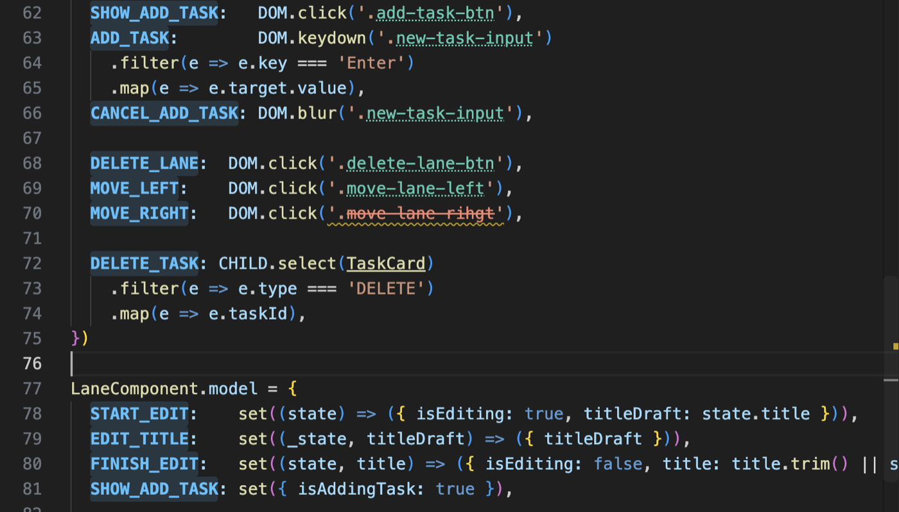

# Sygnal for VS Code

Diagnostics, explanations, quick fixes, completions, go to definition, code lenses, wiring highlights and a safe rename for [Sygnal](https://sygnal.js.org/) apps, as you type.

Sygnal's wiring mistakes fail silently at run time: an intent selector the view never renders, an action with no model entry, an EVENTS type nobody listens to, a child component's class used in the parent. This extension runs [`sygnal-check`](https://www.npmjs.com/package/sygnal-check), Sygnal's static checker, as a language server, so these show up in the editor as soon as you write them, with the same rules and settings as the CLI and your CI.

<!-- Screenshot: a SYG110 squiggle with its hover and the "Change '.incc' to '.inc'" quick fix. -->

## Features

- **Findings as you type**, for the whole project: a change in one file can create or clear a finding in another (EVENTS, child components, Collections), and those files are updated too. Each finding names the component, the problem and the fix, and links its code to the [error reference](https://sygnal.js.org/reference/errors).
- **Hover** on a finding: what the code means, why it fails silently, and how to fix it.
- **Quick fixes** (`Ctrl+.` / `Cmd+.`): the checker's suggestions, such as "Change '.incc' to '.inc'" or "Add a model entry for 'SAVE'", and "Suppress SYGnnn on this line".
- **Fix all**: `Sygnal: Fix All in File` applies every mechanical fix in the file (what `sygnal-check --fix` does). To run it on save:

  ```json
  "editor.codeActionsOnSave": { "source.fixAll.sygnal": "explicit" }
  ```

- **Completions** for the names Sygnal wires by string, which TypeScript can't complete: in `DOM.click('.` the view's classes (after `#`, its ids), in a model key the actions nothing handles yet (as a `NAME: (state, data) => ...` snippet), in `EVENTS.select('` the EVENTS types emitted in the project, in `next('` the model's actions, in `<Collection from="` the state keys. Elsewhere TypeScript's completions stand alone.
- **Go to definition and Find All References** (`F12`, `Shift+F12`) on actions, EVENTS types, selectors, state keys and context entries: from an intent key to its model entry and back, from `EVENTS.select('SAVED')` to every emitter in the project, from `'.save'` to the element that renders it.
- **Code lenses** above intent keys, model keys and EVENTS selects / emits: `handled by model.SAVE · STATE, EVENTS 'SAVED'`, `triggered by intent, next from RESET`, `2 emitters`, or `no model entry` / `not triggered`. Click one to see its targets in a peek view. Turn them off with `"sygnal.codeLens": false`.
- **Highlights** of Sygnal's wiring, over your theme's colors:

  

  | What | Look |
  |---|---|
  | Action names, wherever they're wired (intent keys, model keys, `next()`, reply names, ...) | bold, with a tint behind them; a wavy underline when no model entry handles the action |
  | EVENTS types (`EVENTS.select('SAVED')`, `event('SAVED', ...)`) | italic |
  | Intent selectors (`DOM.click('.save')`) | dotted underline; **dashed amber** when no static class renders it but a dynamic class name in the view might, **struck through in red** when nothing renders it |
  | The view classes, ids and control tags an intent selects | tinted; classes no intent selects stay plain |
  | Child components selected with `CHILD.select(Child)`: the call, `<Child>` / `<Collection of={Child}>` in the view, and Child's name | underlined |

  Only names the checker resolved are highlighted, never a guess. The colors are theme colors you can change in `workbench.colorCustomizations`: `sygnal.highlight.action`, `.actionBackground`, `.event`, `.target`, `.targetBackground`, `.unverified`, `.missing` and `.child`. Turn the highlights off with `"sygnal.highlights": false`.
- **Rename** (`F2`) of an action, an EVENTS type, a class or id, a state key or a context entry, everywhere it is wired: intent, model, `next()`, reply names, emitters and selects in other files. It refuses, with the reason, when it can't find every use (a built-in, a spread in the model, a name built at run time, the same string elsewhere in the code); VS Code then offers TypeScript's rename where it has one. Mentions in test files are a separate group that opens the refactor preview, so you confirm them.
- **App graph** (`Sygnal: Show App Graph`, also in the editor's context menu and the `…` menu of a JS / TS editor): the page of `sygnal-check --graph=html` in a panel beside your code, one per project. Every component, what renders what, EVENTS, context and `PARENT` edges, and the project's findings grouped as a health list. It updates as you type (unsaved changes included), keeping the view and the selection; moving the cursor into a component selects it (a component counts from its first line to the next component in the file); the file links in the details open the file at that line. It uses your theme's colors and works offline: the page loads nothing and runs no app code. The panel's graph comes from the language server, so a project's own `sygnal-check` needs 0.10.0 or later for it (the bundled copy has it). See [The App Graph](https://sygnal.js.org/guide/app-graph/) for what the page shows.
- **Snippets** for `.jsx` and `.tsx` files, in Sygnal's canonical forms:

  | Prefix | Inserts |
  |---|---|
  | `sygcomp` | a component: destructured view, `intent`, object-form `model`, `initialState` (in `.tsx`: `Component<State, {}, {}, ActionsOf<typeof intent>>` and `IntentSources`) |
  | `sygeffect` | a model entry with an `EFFECT` sink |
  | `sygevent` | a model entry that updates state and emits a global event with `event()` |

## Commands

| Command | |
|---|---|
| `Sygnal: Restart Server` | Restarts the language server (and picks the `sygnal-check` again, e.g. after you install it) |
| `Sygnal: Show Output` | The server's log. Clicking **Sygnal** in the status bar does the same |
| `Sygnal: Explain Code…` | Pick any SYG code to read its explanation |
| `Sygnal: Fix All in File` | Applies every auto-fixable Sygnal fix in the active file |
| `Sygnal: Show App Graph` | Opens the app graph of the active file's project (or of the workspace folder) in a panel |

## Which sygnal-check it runs

1. **Your project's own** `node_modules/sygnal-check`, when it is version 0.11.0 or later. This version checks the installed Sygnal separately for each source package: 6.x keeps pre-update reducer snapshots, while 7.x defaults to updated snapshots and remounts known changed state bindings. The editor then reports exactly what your CLI and CI report.
2. Otherwise, the **copy bundled with the extension**. The status bar item shows which one is in use: hover over **Sygnal** for the version and where it comes from. Older checkers, including versions that have a language server, predate this compatibility support. If your project has an older `sygnal-check`, the extension says so once and suggests `npm i -D sygnal-check@latest`.

In a workspace you haven't trusted (Restricted Mode), the extension only runs its bundled copy, never code from the workspace.

The server runs on VS Code's own Node.js, so you don't need Node installed for the bundled copy.

## When it runs

The extension activates in a workspace with a `sygnal-check.config.json`, or when you open a JavaScript or TypeScript file. It starts the server only when a workspace folder uses Sygnal: a `sygnal-check.config.json`, or a `package.json` that depends on `sygnal` or `sygnal-check` (or has a `"sygnal-check"` config key). Otherwise it stays idle, and starts once one of those files appears.

Each workspace folder is checked as its own project. A folder with no Sygnal components gets no findings.

## Settings

By default every setting is unset (`null`), so the config file decides, and the editor, the CLI and CI check the same way. A setting you set overrides the config file. All of them can be set per workspace folder (`.vscode/settings.json`).

| Setting | Type | |
|---|---|---|
| `sygnal.strict` | boolean | Also run the strict-mode rules (canonical forms, SYG5xx), like `--strict` |
| `sygnal.a11y` | `"warn"` \| `"error"` | Severity of the accessibility findings (SYG7xx) |
| `sygnal.ignore` | string[] | Codes to drop, e.g. `["SYG105"]`. Replaces the config file's list |
| `sygnal.paths` | string[] | Files, directories or globs to check, relative to the folder (e.g. `["src"]`, `["pages"]` for Vike) |
| `sygnal.verbose` | boolean | Also show info findings |
| `sygnal.codeLens` | boolean | Show the code lenses (default: on). An editor setting only, not in the config file |
| `sygnal.highlights` | boolean | Highlight the wiring (default: on). An editor setting only, not in the config file |
| `sygnal.trace.server` | `"off"` \| `"messages"` \| `"verbose"` | What the server logs to the Sygnal output |

## The config file

Put the project's settings in `sygnal-check.config.json` at the project root, so the CLI, CI and the editor share them:

```json
{ "strict": true }
```

or in `package.json`:

```json
{ "sygnal-check": { "strict": true } }
```

See the [`sygnal-check` README](https://github.com/tpresley/sygnal/tree/main/sygnal-check#configuration) for every key.

## Other editors and agents

The server is `sygnal-check lsp`, a standard Language Server Protocol server on stdio, so other editors can use it too: see [the docs](https://sygnal.js.org/).

## Links

- [Sygnal documentation](https://sygnal.js.org/)
- [Diagnostic codes](https://sygnal.js.org/reference/errors)
- [Issues](https://github.com/tpresley/sygnal/issues)

## License

MIT
