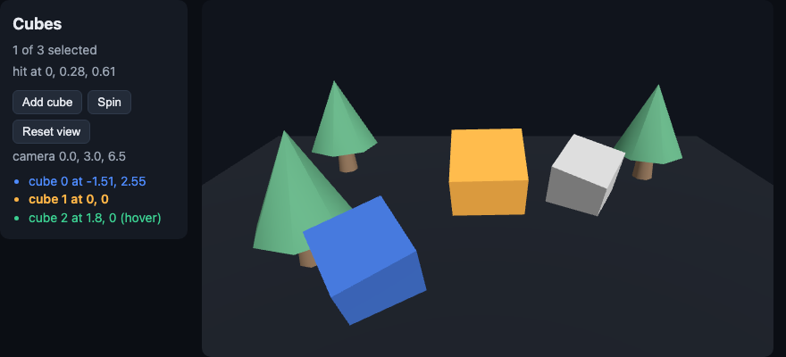

# Cubes: a three.js scene in a Sygnal app

`sygnal/three`'s `<Scene>` inside an ordinary component tree. Each cube is a `Collection` item with its own intent and model: a click in the canvas is a raycast, dispatched as a DOM `click` on the cube's `<mesh>` element, so `DOM.click('.cube')` takes it, as it would for a button.

- Click a cube to select it (the point it hit goes into state), hover it, double-click to remove it, **Add cube**.
- Drag a cube: it slides along the floor (`capture="xz"`: the pointer stays the cube's from the press to the release, even off the canvas), and the camera doesn't orbit meanwhile. A drag doesn't select.
- The trees are a GLTF model (`<Model src="/models/tree.glb" />`, three copies of one load), with a `<Suspense>` fallback of wireframe cones inside the scene until it arrives. `public/models/tree.glb` is made by `scripts/make-tree.mjs` (self-made, CC0).
- **Spin**: the rotation is an `animate` function the scene evaluates each frame, so spinning costs no action, render or patch.
- Drag to orbit (OrbitControls). The camera is a controlled value: an orbit goes into state without being written back, and **Reset view** writes it.
- Keyboard: Tab reaches the cubes (they are buttons in the accessibility tree), Enter or Space selects, and a ring is drawn where the focused cube is.

```bash
npm install
npm run dev     # http://localhost:5173
npm test        # jsdom, no WebGL: the scene runs headless, the raycasts and the GLTF parse are real
```



Guide: [three.js](https://sygnal.js.org/renderers/three/).
