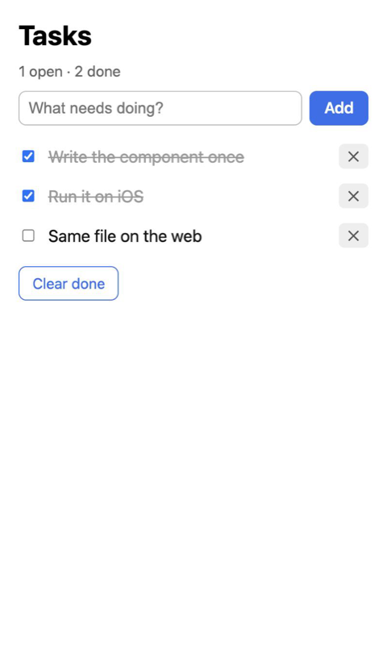
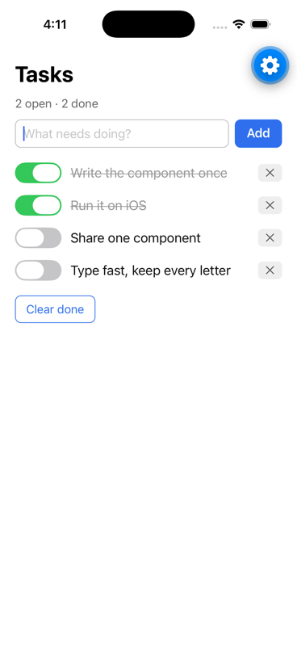
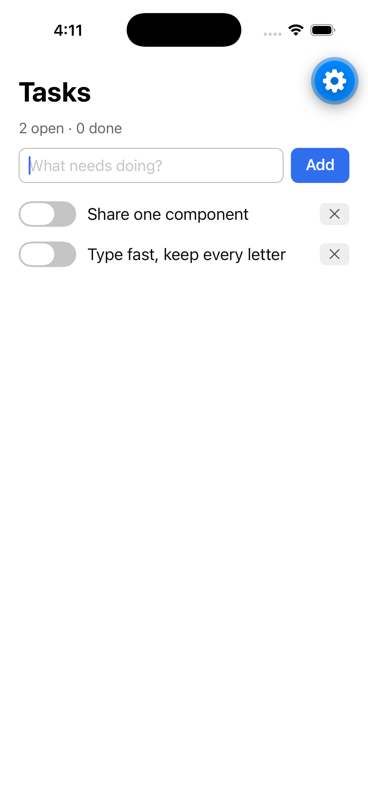

# Tasks: write once (web, iOS, terminal)

One component file, [src/Tasks.jsx](src/Tasks.jsx), written with `sygnal/primitives` and controls, running unchanged on:

| Target | Entry | Run |
|---|---|---|
| the browser (DOM driver) | [src/main.js](src/main.js) | `npm run dev` |
| iOS / Android (`sygnal/react-native`, Expo) | [index.js](index.js) | `npm run ios` (Expo Go in the iOS simulator) |
| a terminal (`sygnal/terminal`) | [src/terminal.jsx](src/terminal.jsx) | `npm run terminal` |

The agent UI (`sygnal/agent-ui`) runs it too; see the tests.

| Web | iOS simulator (Expo Go) | after "Clear done" |
|---|---|---|
|  |  |  |

The terminal, in [screenshots/terminal.txt](screenshots/terminal.txt):

```
TASKS
1 open · 1 done
[What needs doing?] [Add]
[x] Write the component once [✕]
[ ] Run it on iOS [✕]
[Clear done]
```

What makes it portable:

- **The primitives** (`View`, `Text`, `Pressable`, `TextInput`, `Switch`, `List`) render HTML on the web and React Native components on iOS. The terminal and the agent UI read them as text and roles.
- **Styles are React Native style objects**, in the component itself. On the web, lengths become `px` and React Native's shorthands are expanded.
- **Intents select controls** (`DOM.click(Add)`, `DOM.change(Done)`). React Native's `onPress` / `onChangeText` / `onValueChange` arrive as the DOM's `click` / `input` / `change`.

Notes for the native side:

- `metro.config.cjs` serves `sygnal` from this repository (the `file:` link), and pins `react` and `react-native` to this app so there's one React.
- `src/Tasks.jsx` starts with `/** @jsxImportSource sygnal */`, because Metro's Babel preset compiles JSX for React by default. Vite (`sygnal/vite`) doesn't need it.
- Expo Go needs no native build. A native build (`expo run:ios`) needs CocoaPods. `ios/` and `android/` are gitignored.

Tests ([src/Tasks.test.js](src/Tasks.test.js)) run the logic under `renderComponent`, then the same file in a terminal and under agent tool calls: `npm test`. The native bridge has its own tests in the library (`test/renderers-react-native.test.js`).

Guides: [Write Once](https://sygnal.js.org/renderers/write-once), [React Native](https://sygnal.js.org/renderers/react-native).
